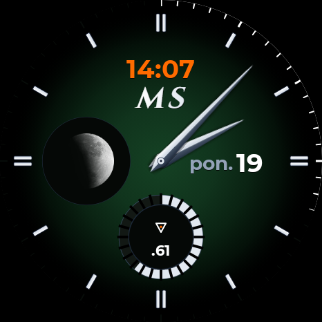

# Fumé Emerald (Wear OS 6 / WFF v2)

[](https://developer.android.com/training/wearables/wff)
[](https://developer.android.com/training/wearables/wff)
[-orange.svg)](https://www.oneplus.com)
[-brightgreen.svg)](https://github.com/antarct/MSWF/releases/tag/v1.0)
[](https://creativecommons.org/licenses/by-nc-nd/4.0/)
[](https://github.com/antarct/MSWF/releases)

A bespoke, uncompromising **Haute Horlogerie** watch face built on pure **Watch Face Format v2 (WFF v2)** for Wear OS 5 and Wear OS 6 (Android 15 / 16). Originally developed for **OnePlus Watch 4** (`OPWWE261`, 466×466 px AMOLED) and fully compatible with **Samsung Galaxy Watch 4 / 5 / 6 / 7 / Ultra** (One UI 5 / 6 / 8).



---

## 🌟 Key Features & Design Philosophy

1. **Velvety Emerald Fumé:**
   * Seamless, non-linear vignette roll-off from a saturated emerald green center into 100% pure AMOLED black beneath the perimeter indices.
   * **Living Dial (Activity-Driven Bloom):** At dawn, the dial rests in a stealth onyx tone. As daily movement progress (`[STEP_PERCENT]`) increases, the emerald bloom awakens proportionally until reaching full saturation at 100% of the daily goal.
   * Three user-selectable themes available via on-watch customization: *Living Emerald*, *Always Emerald*, and *Pure Onyx*.
2. **Swiss Super-LumiNova Perimeter Seconds:**
   * Outer track featuring 60 calibrated minute/second ticks.
   * Smooth, hardware-masked vector arc (`<Arc>`) dynamically illuminating each second marker clockwise and resetting cleanly at the top of each minute.
3. **3D Platinum-Faceted Hands:**
   * Dual-facet analog hands with a mirror-polished chamfer (platinum left facet, deep graphite right facet) cast over soft ambient drop shadows.
   * Central minimalist polished steel mounting rivet (10 px) seamlessly integrated with the Dauphine hands.
4. **Dynamic Complication Subdials (Scale +28%):**
   * **6H Axis (Bottom Subdial):** Dual-mode support: Bespoke Delta (minimalist battery telemetry with full glowing ring at 100%) or standard Wear OS complication provider (`WATCH_BATTERY`).
   * **9H Axis (Left Subdial):** Dual-mode support: Bespoke Solar gauge or standard Wear OS complication provider (`STEP_COUNT`, weather, heart rate, calendar, etc.).
   * **Universal Wear OS 5/6 Complication Support:** Native handling for `RANGED_VALUE`, `GOAL_PROGRESS`, `SHORT_TEXT`, `MONOCHROMATIC_IMAGE`, `SMALL_IMAGE`, and `EMPTY` (Quiet Luxury mode).
   * **Interactive Tap Actions:** Tapping either subdial instantly triggers the native details application via Wear OS `PendingIntent`.
   * **True 128×128 px Canvas:** Uncompromised circular geometry preventing any cardinal edge clipping or asymmetrical slit truncation.
5. **Harmonious Typography & Date Window:**
   * Clean geometric **Montserrat Bold** across all numerals and labels.
   * Integrated 3H date window (`sob. 17` / `SAT 17`) with a calibrated 5 px optical gap, centered between the pinion and 3H baton.
   * Vivid orange digital time (`#ff6b00`) at 12H beneath the italic small-caps **MS** monogram.
6. **Ultra-Low-Power AOD (Ambient Mode) Hardened:**
   * On-Pixel Ratio (OPR) strictly below **3.5%**.
   * Hardened with mathematical `(1 - [IS_AMBIENT])` factors on all dynamic transforms, completely eliminating display buffer latching or frozen seconds arcs across all Wear OS 5/6 devices.
   * Pure `#000000` AMOLED pixels physically unmapped (0 mA draw).

---

## 📁 Repository Structure

```
MSWF/
├── wff-project/                 # Declarative Watch Face Format project
│   ├── AndroidManifest.xml      # WFF application manifest (hasCode="false")
│   └── res/
│       ├── raw/watchface.xml    # Watch face scene declaration, layers, and formulas
│       ├── values/strings.xml   # Default English strings and customization labels
│       ├── values-pl/strings.xml# Polish localization strings
│       ├── xml/watch_face_info.xml # Wear OS editor metadata
│       ├── font/                # Embedded Montserrat Regular & Bold TTF fonts
│       ├── drawable-nodpi/      # High-density 32-bit RGBA graphical assets
│       └── drawable/            # Package preview icon (preview.png)
├── scripts/
│   ├── generate_assets.js       # Headless Edge Chromium script generating dial & 3D hand PNGs
│   ├── build_and_deploy.js      # Automated AAPT2 compilation, signing, and wireless ADB deployment
│   ├── render_comparison.js     # Headless simulator comparing Active and AOD modes locally
│   └── get_android_jar.js       # Auto-bootstrapping script for android.jar from Maven Central
├── concept/
│   └── watchface_concept_preview.html # Interactive HTML5/SVG prototype and calibration viewer
├── dist/
│   ├── fume-emerald-v1.0.apk    # Signed, zip-aligned production-ready APK
│   └── watch_live_capture.png   # Raw screencap taken directly from the physical watch
├── docs/
│   └── ARCHITECTURE_AND_POWER_ANALYSIS.md # Engineering report on power architecture & telemetry
├── tools/
│   ├── aapt2.exe                # Android Asset Packaging Tool 2
│   └── uber-apk-signer.jar      # Automated APK alignment and debug-signing tool
├── .gitignore
└── README.md
```

---

## 🚀 Building & Deployment

### Prerequisites:
* Node.js v18+
* Java JRE/JDK (for `uber-apk-signer.jar`)
* ADB (Android Platform Tools)

### 1. Compile & Sign APK:
```bash
node scripts/build_and_deploy.js
```
The resulting signed package will be generated at `dist/fume-emerald-v1.0.apk`.

### 2. Deploy to Watch (over Wireless ADB):
```bash
node scripts/build_and_deploy.js --deploy
```

---

## 📜 Version History

* **v1.0 (versionCode 100) – Official Release:**
  * **Dynamic Complications:** Full Wear OS complication framework integration on positions 6H (bottom) and 9H (left).
  * **Interactive Touch Routing:** Tapping complications immediately opens their corresponding apps (Battery settings, Samsung Health, OHealth, Weather, Calendar).
  * **AOD Freeze Immunity:** Hardened Ambient Mode transitions with explicit mathematical `(1 - [IS_AMBIENT])` factors across all active transforms, completely eliminating display buffer latching and frozen seconds arcs on Samsung Galaxy Watch (Wear OS 6 / One UI 8) and OnePlus Watch 4.
  * **Haute Horlogerie Clean Design:** Custom non-destructive subdial mask asset (`subdial_clean.png`) eliminating provider icon collisions.
  * **Pure WFF v2 Standard:** Pure declarative Watch Face Format v2 (`minSdkVersion 34`, `targetSdkVersion 35`, `hasCode="false"`).
  * **Dual Locale:** English default with native Polish translation (`values-pl`).
  * **Ultra-Low-Power AOD:** On-Pixel Ratio (OPR) strictly below **3.5%** with true AMOLED black (`#000000`).

---

## 📄 License & Terms of Use

This project, its Haute Horlogerie design assets, 3D hand renders, and declarative code are licensed under the **Creative Commons Attribution-NonCommercial-NoDerivatives 4.0 International Public License (CC BY-NC-ND 4.0)**.

* **Attribution (BY):** You must give appropriate credit to the author (**Mariusz / antarct**), provide a link to the license, and indicate if changes were made.
* **NonCommercial (NC):** You may not use the material for commercial purposes or monetization of any kind.
* **NoDerivatives (ND):** If you remix, transform, or build upon the material, you may not distribute the modified material.

For the full legal text, see the [LICENSE](LICENSE) file or visit [Creative Commons CC BY-NC-ND 4.0](https://creativecommons.org/licenses/by-nc-nd/4.0/).
